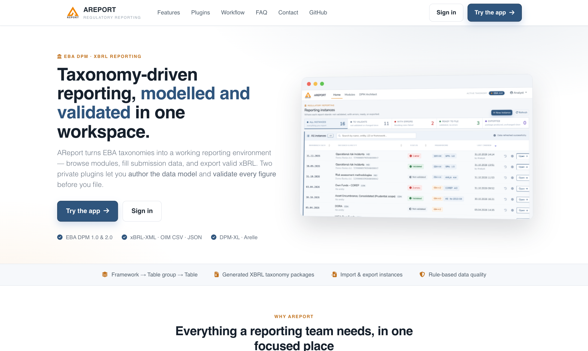

# AReport

AReport is a web application for supervisory reporting with DPM/XBRL taxonomies (EBA, ECB and national extensions). It turns the taxonomy's tables into editable forms, stores the reported facts in a relational database, checks them, and exports filing-ready `xBRL-CSV` and `xBRL-XML` instances.

Taxonomy parsing, table rendering and the instance writers live in the companion package [`begicf/areport-dpm-xbrl`](https://github.com/begicf/areport-dpm-xbrl).

Website: <https://areport.net>

[](https://areport.net)

## Features

### Taxonomies
- Upload taxonomy packages (ZIP) and switch the active taxonomy; every instance and fact is scoped to its taxonomy.
- DPM `1.0` and DPM `2.0` taxonomies (tested with EBA 4.2 and 4.4), including open tables, typed dimensions and owner extensions (e.g. a national regulator's modules next to EBA's).
- The taxonomy page shows the frameworks and module versions each package contains.
- Module explorer with an owner filter (All / EBA / own), search, and expand or collapse all.

### Reporting
- Instances belong to a user and are addressed by id. Each instance has a reporting entity (LEI and name), a reference date and filing settings.
- Every template renders as an HTML form:
  - Enumerations become dropdowns that follow the hierarchy (indented members, members of other domains).
  - Percentages are entered as %.
  - Open tables add rows with their key.
  - Typed z-axes add sheets by key value (`Add key`), with suggestions of identifiers already used in the instance (e.g. C_27 → C_28/C_29).
- Explicit save, autosave and an audit trail. Large sheets save without hitting PHP's `max_input_vars`.
- Live validation on the form: cells that break a rule are marked red (error) or amber (warning), and a tooltip on the cell shows the rule.
- Instance status and a home dashboard with a status filter.

### Checks and export
- Filing indicators for every template of the module.
- Pre-export checks:
  - open-table rows and typed sheets must have their key;
  - no `xBRL-XML` from reference date 31.03.2026;
  - other EBA filing rules.
- `xBRL-CSV` report packages and `xBRL-XML` instances following the EBA filing rules:
  - one context per member set, and one fact per concept and context;
  - shared datapoints reported once;
  - open-table rows carry their keys;
  - typed members are written correctly.
- On the 10 EBA 4.2 sample modules that were tested, exports match the official samples fact for fact.
- Export dialog option to check the exported instance with [Arelle](https://arelle.org) (offline, against the local taxonomy copy).
- Export to `.xlsx`, `.pdf` and `.html`, and import from spreadsheets and structured files.

### Workspace
- Settings for reporting entities (LEI lookup in the GLEIF register), the taxonomy owner and regulator, and translation languages.
- Sign-in requires a verified email address.
- Optional demo mode that shares one user's instances with every signed-in user.
- Public landing page with a spam-protected contact form.

### Private plugin: AReport Pro
The optional `begicf/areport-pro` package is private, not public. When it is installed, it adds:
- **DPM Architect**: author tables, modules, the data dictionary and validation rules, then generate the XBRL taxonomy (schemas, linkbases, `*-lab-<lang>.xml`). **Export** packs the chosen frameworks as an XBRL taxonomy package, with an optional Arelle check of every module.
- **Validation**: DPM 2.0 / DPM-XL rules, evaluated by the separate `dpm-xl-service`.
- **Label translation**: labels translated in the Architect and the dictionary, with optional AI suggestions from Claude.

AReport works without the plugin; the related screens and actions are simply hidden.

## Requirements

- PHP `8.3+` with the `zip` and `dom` extensions
- Composer, Node.js and npm
- MySQL/MariaDB (or another database supported by Laravel)
- Optional: Arelle (`arelleCmdLine`) for checking exported instances

The application runs on Laravel `13`, Bootstrap `5.3`, PhpSpreadsheet and mPDF.

## Local development

```bash
git clone https://github.com/begicf/areport.git
git clone https://github.com/begicf/areport-dpm-xbrl.git   # sibling folder, symlinked by Composer
cd areport

composer install
npm install && npm run prod

cp .env.example .env
php artisan key:generate
php artisan migrate --seed
php artisan storage:link

php artisan serve
```

`composer.json` points `begicf/areport-dpm-xbrl` at `../areport-dpm-xbrl` (path repository, symlinked), so changes to the library apply right away. The private `areport-pro` plugin is linked the same way from `../areport-pro` when it is present.

## Configuration

The main application variables in `.env`:

| Variable | Purpose |
|---|---|
| `UPLOAD` | `1` allows taxonomy uploads from the UI |
| `LEI_CODE` | fallback LEI when no reporting entity is set |
| `AREPORT_CONTACT_TO` | recipient of contact form messages (default `info@areport.net`) |
| `AREPORT_DEMO_SHARED_USER_ID` | demo mode: whose instances every signed-in user sees (`0` = off) |
| `AREPORT_EDITION`, `AREPORT_EXTENSION_PROVIDERS` | edition label and extra service providers |

With the AReport Pro plugin:

| Variable | Purpose |
|---|---|
| `AREPORT_PRO_ARELLE_CMD` | path to `arelleCmdLine` (e.g. a venv's `bin/arelleCmdLine`) |
| `AREPORT_PRO_DPMXL_SERVICE_URL` | DPM-XL service (default `http://127.0.0.1:8077`) |
| `AREPORT_PRO_DPM_OWNER_*`, `AREPORT_PRO_DPM_REGULATOR_*` | owner and regulator of authored taxonomies (also editable under Settings) |
| `ANTHROPIC_API_KEY`, `AREPORT_PRO_AI_MODEL` | AI translation with Claude (can also be set under Settings › AI translation) |

For large taxonomy uploads, raise the PHP limits in `php.ini`:

```ini
max_execution_time = 6000
upload_max_filesize = 4000M
post_max_size = 4000M
```

Taxonomy packages are unpacked under `storage/app/public/tax/<folder>`.

## Testing

```bash
php artisan test
```

The tests use an in-memory SQLite database. Tests that need the private plugin are skipped when it is not installed.

## Deployment

Each push to `master` deploys <https://demo.areport.net> through GitHub Actions (`.github/workflows/deploy.yml`). The deploy pulls the sibling repositories, runs `composer install` and the migrations, then reloads the application. A change that needs a new `.env` value has to be set on the server separately.

## Related repositories

- Application: <https://github.com/begicf/areport>
- Taxonomy parser, renderer and instance writers: <https://github.com/begicf/areport-dpm-xbrl>
